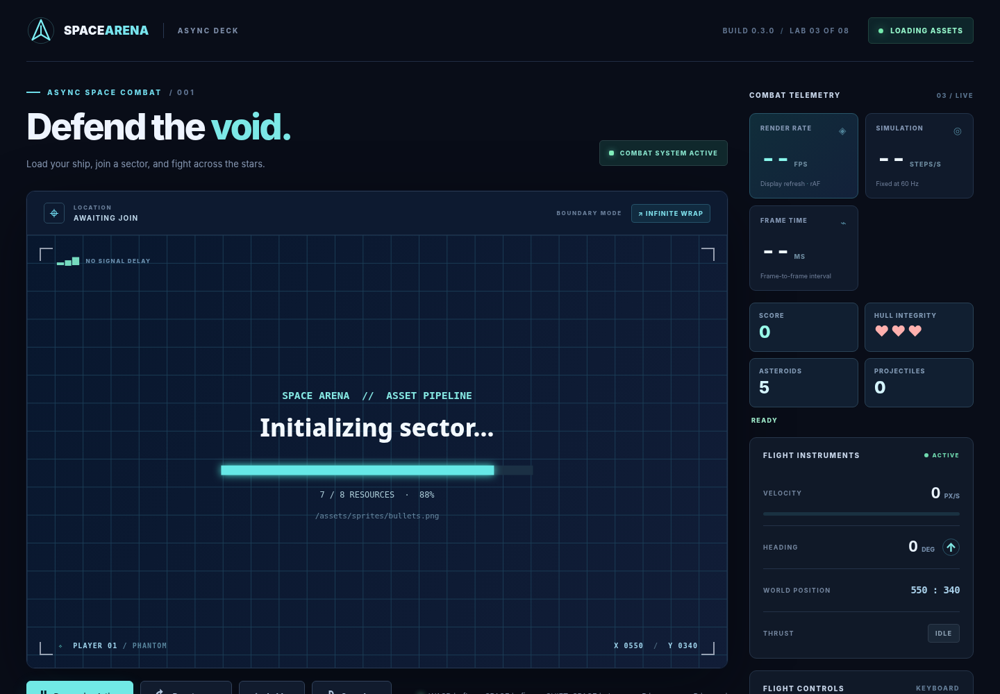
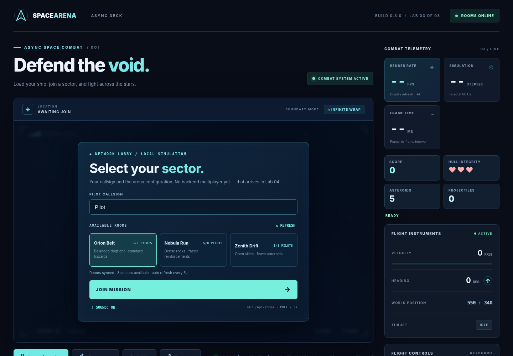
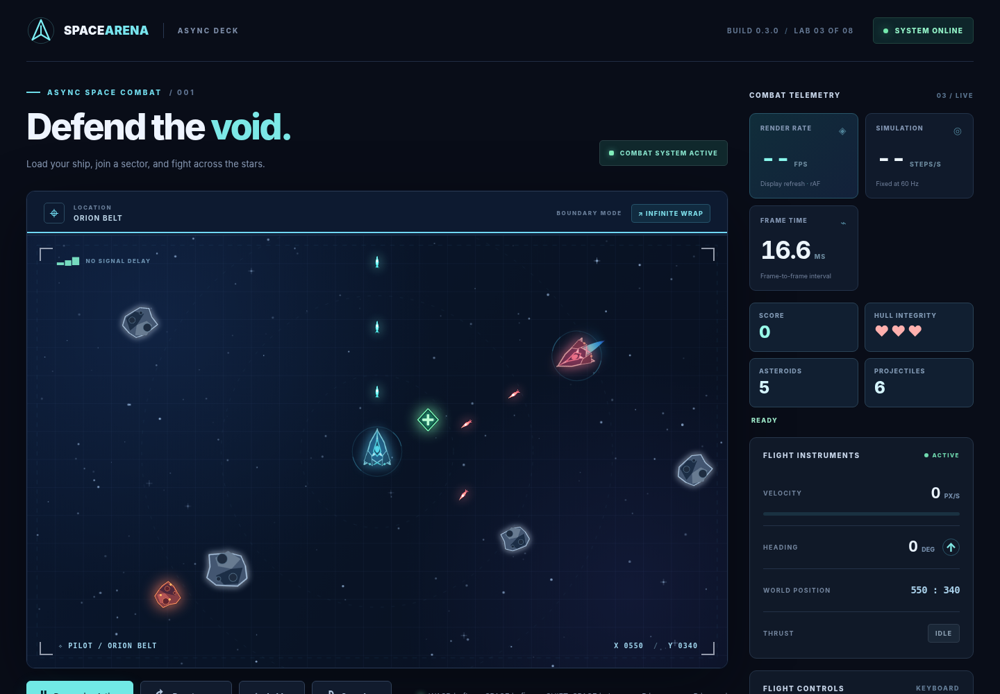
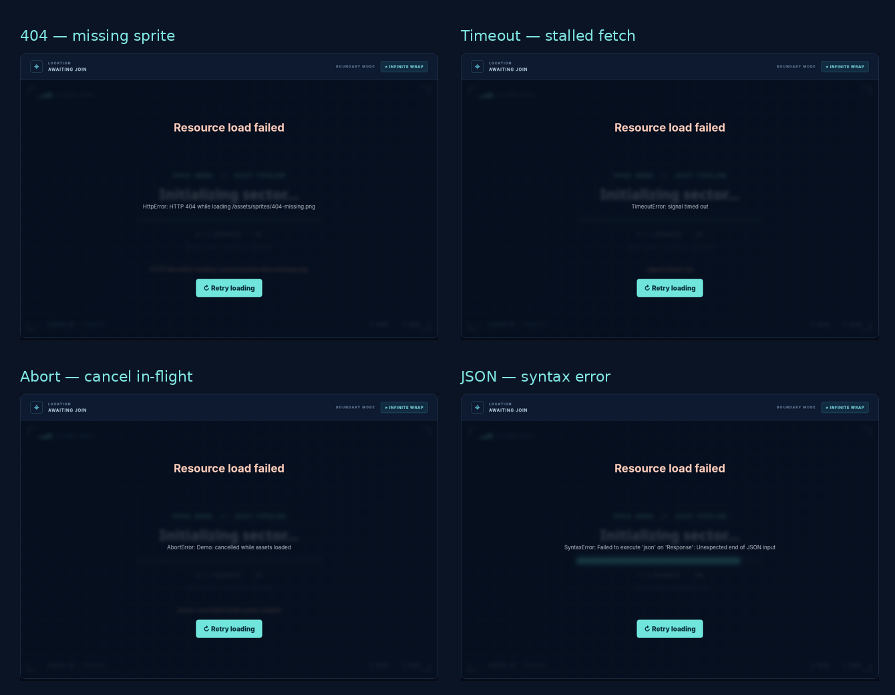

# SPACE ARENA — Lab 03: Async JavaScript, Assets & Lobby

> **Лабораторна №3 — продовження тієї самої Space Arena з ЛР №1–2.** Fixed-step game loop, `Ship extends Entity`, `World`/`Map`, кулі, TTL, колізії, респаун, pickup і homing не вилучено. Додано асинхронне завантаження, PNG-спрайти, Web Audio, події та лобі. У ЛР №3 кімнати — статичний список, **мережевого мультиплеєра поки немає** (це ЛР №4–5).





## 1. Як запустити й показати викладачу

Потрібен **Node.js 22+**. Працюйте в **тому самому публічному GitHub-репозиторії**, не створюйте новий.

```bash
npm install
npm run dev
```

Відкрийте адресу Vite (зазвичай `http://localhost:5173/`). Правильний сценарій:

1. На **Canvas** з'являється реальний progress bar `0/8 → 8/8`; одночасно завантажуються 4 PNG, 3 WAV і 1 JSON.
2. Лише після `await loadAll(manifest)` з'являється **Lobby**; воно читає `GET /api/rooms` зі статичного файлу `public/api/rooms`, оновлює список кожні 5 с.
3. Введіть callsign, оберіть `Orion Belt`, `Nebula Run` або `Zenith Drift`; натисніть **Join Mission** — тільки тоді створюється `Game` і починається ігровий цикл. Вибір кімнати змінює кількість/частоту астероїдів.
4. Керуйте кораблем, стріляйте (`Space`), знищуйте астероїди; почуєте **Web Audio** (після дії Join). Перевірте `Shift + Space` (homing), зелений pickup, HP, бали й 2-секундний респаун.
5. **Lobby** під Canvas повертає до списку кімнат; коли гравець покинув лобі, `setInterval` скасовується й запит переривається.

| Керування               | Результат                         |
| ----------------------- | --------------------------------- |
| `W` / `↑`, `S` / `↓`    | Розгін / гальмо                   |
| `A` / `←`, `D` / `→`    | Поворот                           |
| `Space`                 | Постріл із носа корабля зі звуком |
| `Shift + Space`         | Самонавідні кулі                  |
| `P`, `R`                | Пауза / перезапуск                |
| `Sound on/off`, `Lobby` | Звук / повернення до лобі         |



**Контроль якості (перед здачею):**

```bash
npm run format
npm run check  # eslint + prettier check + всі тести + Vite production build
# або окремо:
npm test
npm run build
```

> `index.html` не запускайте подвійним кліком через `file://`: `fetch`, ESM і шлях `/api/rooms` потребують локального Vite-сервера.

## 2. Структура змін — збережено основу ЛР №1–2

```text
space-arena/                      ← ТОЙ САМИЙ репозиторій
├── index.html                    ← overlays для loading errors і lobby
├── public/
│   ├── api/rooms                 ← GET /api/rooms, статична відповідь до ЛР №4
│   └── assets/
│       ├── manifest.json        ← 8 записів: sprites/audio/json
│       ├── sprites/             ← ships, asteroids, bullets, pickups (PNG atlases)
│       ├── audio/               ← fire, hit, explosion (WAV)
│       └── data/                ← arena.json, broken.json (демо)
├── src/
│   ├── main.js                  ← async boot + Join + wiring + збережена фізика
│   ├── assets/loader.js         ← fetchJson, retry, loadImage/Audio/Json, loadAll
│   ├── assets/failure-demo.js   ← 4 сценарії відмови (тільки query parameter)
│   ├── lobby/lobby.js           ← class Lobby extends EventTarget + poll + async iterator
│   ├── lobby/view.js            ← DOM, вибір кімнати, callsign, кнопки
│   ├── audio/audio.js           ← Web Audio event subscribers
│   ├── ui/loading.js            ← графічний Canvas progress bar
│   ├── sim/game.js              ← старий Game + ін'єкція eventBus/roomConfig
│   ├── render/draw.js           ← старий Canvas renderer + drawImage(frame, sprite)
│   ├── input.js, loop.js        ← без змін із попередніх лабораторних
│   └── sim/інші...              ← Entity, World, вектори, поведінки, колізії
├── tests/                       ← 36 попередніх + 11 нових = 47 тестів
└── docs/
    ├── lab-01-readme.md         ← попередній README першої ЛР
    ├── lab-02-readme.md         ← попередній README другої ЛР
    ├── failure-gallery-lab-03.png
    ├── failure-gallery-lab-03.md
    ├── reflection-lab-03.md
    └── defense-lab-03.md
```

**Інваріанти:** `src/sim/*` не імпортує DOM, renderer або `audio.js`. Клас `Game` приймає `eventBus: EventTarget` через конструктор і повідомляє `CustomEvent('fired' | 'hit' | 'exploded')`; `audio.js` слухає ці події. Кораблі, кулі й астероїди в робочому renderer малюються через `ctx.drawImage` з **реальних PNG-спрайтшитів** (96×96 на кадр), а не замінені на телефонні картинки або окремі CSS-фігури. За відсутності ресурсів гра не стартує.

## 3. Пайплайн assets: Promises / await / AbortSignal

`public/assets/manifest.json` містить `{ id, type, url }`. `fetchResponse` перевіряє `response.ok` й кидає `HttpError` для 4xx/5xx, `fetchJson` після цього виконує `.json()` і передає `SyntaxError` угору. `loadImage` використовує `fetch → blob → createImageBitmap`, `loadAudio` — `fetch → arrayBuffer → OfflineAudioContext.decodeAudioData`, `loadJson` — спільний `fetchJson`. Всі отримують `AbortSignal`. Звуковий `AudioContext` створюється **після user gesture**, під час натискання Join, а не в `boot`.

`withRetry` робить максимум **3 спроби** з backoff `180ms, 360ms + jitter 0–35%`; 4xx, parse error і явний Abort **не повторюються**, 5xx/мережеві помилки/таймаути можуть повторюватися. Кожна спроба має власний `AbortSignal.timeout`; зовнішній abort відміняє весь ланцюжок.

```js
const manifest = await fetchJson('/assets/manifest.json', { signal });
const assets = await loadAll(manifest, {
  signal,
  onProgress: ({ completed, total, file }) => drawLoading(surface, { completed, total, file }),
});
// Promise.all виконується всередині loadAll, після await ресурси вже готові.
// Після цього: renderer із PNG, лобі, Join, а лише потім Game + loop.start().
```

`Promise.all` відхиляється, якщо будь-який критичний ресурс не завантажився; цей exception перехоплює `boot()`, скасовує інші запити й показує Retry. Прогрес показує кількість **успішно завершених файлів**, а не вигаданий відсоток; при одночасній роботі порядок завершення не зобов'язаний збігатися з manifest.

### Вимірювання: sequential `await` vs concurrent `Promise.all`

Функція `measureLoading` проходить ті самі 8 файлів спочатку послідовно (`for ... await`), потім паралельно (`loadAll`). **Три фактичні заміри у headless Chromium**, де всі файлові `fetch` підмінено однаковим локальним тестовим адаптером з **20 мс штучної затримки на запит**; декодування PNG/WAV лишилося браузерним. Це **не** заявлені вимірювання Vite на Mac — повторіть їх на своєму комп'ютері.

| Спроба | Sequential await | Concurrent Promise.all | Прискорення |
| ------ | ---------------: | ---------------------: | ----------: |
| 1      |         177.6 мс |                45.4 мс |        3.9× |
| 2      |         176.8 мс |                30.2 мс |        5.9× |
| 3      |         178.5 мс |                33.4 мс |        5.3× |

**Чому:** послідовний `await` чекає файл N до старту N+1, а `Promise.all` ставить усі `fetch` у роботу одразу. Швидкість залежить від кешу, браузера, мережі та декодера; паралельність **не створює додатковий JS-потік**, а overlapping I/O і роботу асинхронних API.

Власний вимір у Chrome DevTools Console (після завантаження лобі):

```js
window.__spaceArenaDebug.compareAssetLoading().then(console.table);
```

## 4. П'ять власних головоломок: task, microtask, rAF

Приклади запускати **окремо** у браузерній Console. В усіх є `await`, `setTimeout` **усередині `.then`** та `requestAnimationFrame`; вихід збудований так, щоб між timer і rAF не було неозначеної гонки (rAF реєструється всередині timer). `await` відновлює async-функцію як microtask; `.then` теж microtask; `setTimeout` — task; rAF — перед наступним paint.

**Головоломка 1 — один `await`:**

```js
async function a() {
  console.log('A1');
  await Promise.resolve();
  console.log('A3');
  Promise.resolve().then(() => {
    console.log('A4');
    setTimeout(() => {
      console.log('A5');
      requestAnimationFrame(() => console.log('A6'));
    }, 0);
  });
}
a();
console.log('A2');
// Вивід: A1 A2 A3 A4 A5 A6
```

Пояснення: синхронні A1/A2 перед continuation `await` A3, потім `.then` A4, таймер A5, rAF A6.

**Головоломка 2 — `.then` ставиться у чергу раніше, ніж `await`:**

```js
Promise.resolve().then(() => {
  console.log('B3');
  setTimeout(() => {
    console.log('B5');
    requestAnimationFrame(() => console.log('B6'));
  }, 0);
});
async function b() {
  console.log('B1');
  await 0;
  console.log('B4');
}
b();
console.log('B2');
// Вивід: B1 B2 B3 B4 B5 B6
```

Пояснення: B3 уже стоїть у черзі microtasks перед B4, але сам виклик async-функції виконує B1 синхронно.

**Головоломка 3 — два `await` віддають чергу іншим microtasks:**

```js
async function c() {
  console.log('C1');
  await 0;
  console.log('C3');
  await 0;
  console.log('C5');
}
c();
Promise.resolve().then(() => {
  console.log('C4');
  setTimeout(() => {
    console.log('C6');
    requestAnimationFrame(() => console.log('C7'));
  }, 0);
});
console.log('C2');
// Вивід: C1 C2 C3 C4 C5 C6 C7
```

Пояснення: після C3 другий `await` ставить C5 у хвіст microtask queue, поступаючись уже запланованому C4.

**Головоломка 4 — `reject` переходить у `catch` після microtask:**

```js
async function d() {
  console.log('D1');
  try {
    await Promise.reject(new Error('fail'));
  } catch {
    console.log('D3');
    await 0;
  }
  console.log('D5');
}
d();
Promise.resolve().then(() => {
  console.log('D4');
  setTimeout(() => {
    console.log('D6');
    requestAnimationFrame(() => console.log('D7'));
  }, 0);
});
console.log('D2');
// Вивід: D1 D2 D3 D4 D5 D6 D7
```

Пояснення: rejection відновлює `catch` як microtask D3, а `await` у `catch` дає виконатися D4 раніше за D5.

**Головоломка 5 — `await` усередині таймера:**

```js
console.log('E1');
Promise.resolve().then(() => {
  console.log('E3');
  setTimeout(async () => {
    console.log('E5');
    await Promise.resolve();
    console.log('E6');
    requestAnimationFrame(() => console.log('E7'));
  }, 0);
});
(async () => {
  await 0;
  console.log('E4');
})();
console.log('E2');
// Вивід: E1 E2 E3 E4 E5 E6 E7
```

Пояснення: E3/E4 — microtasks поточного завдання; E5 — новий timer task; E6 — microtask після `await` таймера; E7 — rAF.

**Три стани Promise:** `pending`, `fulfilled`, `rejected`. `.then` створює новий Promise, `throw` відхиляє downstream Promise, `.catch` або `try/catch` його обробляє. Колбек, Promise `.then` і `await` — різні інтерфейси одного асинхронного процесу; `await` не блокує браузерний event loop.

Комбінатори: `Promise.all` — усі успішні або перша помилка; `Promise.allSettled` — результати кожного, включно з rejected; `Promise.race` — результат першого завершеного (лобі використовує у async iterator); `Promise.any` — перший **успішний** або `AggregateError`, якщо всі відхилені. Мініприклади див. `docs/async-combinators-lab-03.md`.

## 5. Галерея збоїв — не падаємо, кнопка Retry



У Vite відкрийте посилання по одному: `/?failure=404`, `/?failure=timeout`, `/?failure=abort`, `/?failure=json`. В кожному випадку є помилка на Canvas/overlay та **Retry loading**, яка прибирає demo-параметр і без перезавантаження вкладки виконує нормальний `boot()` → лобі. Не треба видаляти реальні файли з проєкту.

| Сценарій           | Механізм                                            | Очікувана реакція                            |
| ------------------ | --------------------------------------------------- | -------------------------------------------- |
| `?failure=404`     | Підміна URL `ships.png` на неіснуючий               | `HttpError 404`, **немає ретраю 4xx**, Retry |
| `?failure=timeout` | Невідповідний `fetch` + timeout 350 мс/спроба       | `TimeoutError` після 3 спроб, Retry          |
| `?failure=abort`   | `AbortController.abort()` на 280 мс під час запитів | `AbortError`, без ретраю, Retry              |
| `?failure=json`    | Неповний `broken.json`                              | `SyntaxError` на `.json()`, Retry            |

Власний smoke-test у headless Chromium виконав кожен збій та натискання Retry: **4/4 повернулися до лобі з 3 кімнатами, без uncaught JavaScript errors**. Browser harness подав ті самі ESM/HTML/CSS і бінарні ресурси через локальний test adapter, **не Vite HTTP navigation**. Повний сценарій захисту — `docs/failure-gallery-lab-03.md`.

## 6. Lobby, EventTarget, Web Audio

`Lobby extends EventTarget` відповідає лише за модель (`rooms`, `join`, `refresh`, `start`, `stop`) та `CustomEvent('rooms' | 'roomerror' | 'join')`. UI в `src/lobby/view.js`; кнопки та список кімнат не в класі Lobby. Коли лобі видиме, `setInterval` викликає асинхронний `refresh()` раз на 5 с. На кожен запит використовується `AbortSignal.any([controller.signal, AbortSignal.timeout(2400)])`; `stop()` перериває незавершений fetch, прибирає timer і запобігає оновленню UI старою відповіддю через `generation`. `async *updates` повертає зміни, а `main.js` читає їх через **`for await (... of ...)`**.

Після натискання Join `audio.unlock()` створює/відновлює справжній `AudioContext`, а до цього `loadAudio` лише декодує у `OfflineAudioContext` (без autoplay). Підписки на `fired`, `hit`, `exploded` знаходяться в `src/audio/audio.js`, а `src/sim/game.js` лише надсилає події в передану шину, не імпортуючи звук/HUD.

## 7. Захист і GitHub

**П'ятихвилинний показ:** loading bar → lobby з трьома кімнатами → Join → постріл зі звуком і sprites → коротко Promise.all/retry/AbortController/EventTarget → 2–3 відповіді з `docs/reflection-lab-03.md` (сценарій `docs/defense-lab-03.md`).

Переконайтесь, що локальна гілка вже підключена до існуючого `origin` і не містить невідправлених змін інших людей:

```bash
git status
git add .
git commit -m "Lab 03: async assets, loading screen, lobby and Web Audio"
git tag lab-03
git push origin main
git push origin lab-03
```

Здається **той самий репозиторій**: `https://github.com/top4icsem/space-arena`, з окремими тегами `lab-01`, `lab-02`, `lab-03`. Для інструкції копіювання файлів з ZIP поверх наявної папки див. `ЯК_ДОДАТИ_ЛР3.md`. **Не копіюйте чужу `.git` і не створюйте новий `git init`.**

**Статус перевірки в середовищі створення:** 47/47 Node tests; браузерний smoke-test ESM/DOM/Canvas/PNG/WAV/lobby/fire; 4/4 recoverable failures. npm registry тут недоступний, тому `npm run lint`, `npm run format:check` і Vite `npm run build` потрібно виконати на своєму Mac перед пушем; цей README не стверджує, що вони вже пройшли.
