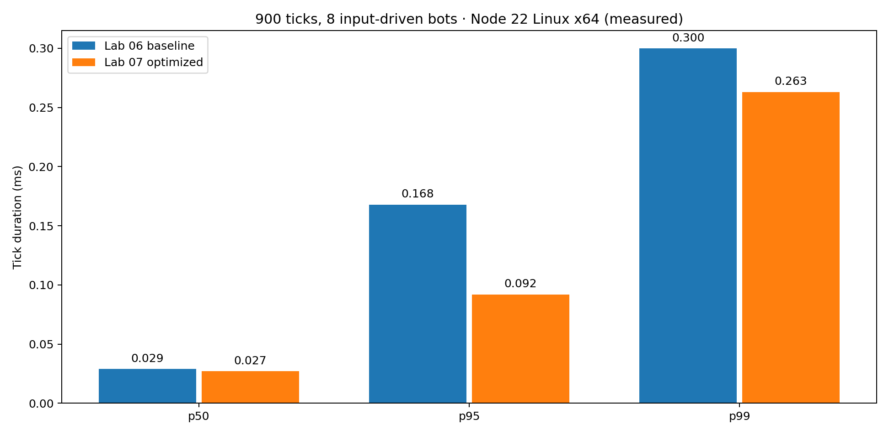

# SPACE ARENA — Lab 07: V8, Memory and Testing

> **Milestone 7 of 8.** The **same public repository** with authoritative multiplayer from Labs 04–06, strict TypeScript/Zod, plus systematic testing, profiling and memory optimisation. The legacy `lab-01` … `lab-06` tags remain unchanged.


**Assignment:** [Lab 07 — V8, Memory and Testing](https://github.com/rmalkevy/Programming-Practice-Projects/blob/main/courses/javascript/lab-07-engine-performance-testing.md) · [Notes](https://github.com/rmalkevy/Programming-Practice-Projects/blob/main/courses/javascript/lab-07-engine-performance-testing.notes.md)

## 1. Install and run

Node.js **22.16+**, npm, Chromium. In the **existing** `space-arena-lab-02` folder:

```bash
npm install
npx playwright install chromium
npm run format
npm run check              # lint, format, strict TS, old tests, Vitest+coverage >=85%, Vite build
npm run test:e2e           # actual two browser contexts, chat and remote movement
npm run dev
```

Follow the **Vite Local URL** from the terminal. In two tabs, enter different callsigns, join the same room and fight. With `/?bots=8`, the server adds 8 input-driven AI ships. `GET http://127.0.0.1:3000/api/perf` shows the latest authoritative tick timing percentiles. Built-in `Orion Belt`, `Nebula Run` and `Zenith Drift` remain available after everyone leaves. In-game input keys: W/A/S/D, Space, Shift+Space, P, R.

You can also test headless 8/32/64/128 WebSocket clients with `npm run bench:clients`, and optional Web Worker backdrop generation via `/?worker=1`.

## 2. Testing across three workspaces

Vitest 3.x has project configurations in `shared/vitest.config.ts`, `server/vitest.config.ts`, `client/vitest.config.ts`; the root `vitest.config.ts` aggregates projects. The test suites include **at least 60 individual cases** when `it.each` variants are counted separately, including:

- Shared vector/flight equivalence, boundary wrap, collisions, score, respawn, TTL, seeded determinism, input ack, codec length, angle rounding and malformed input.
- **Seven fast-check properties:** DataView input roundtrip; encoded snapshot size; corrupt buffers raise controlled errors; ship always wraps into arena; JSON schema accepts legitimate and rejects corrupt input; angle quantisation bound; `advanceInto` matches pure `advance`.
- Server rooms/persistence, target-clock scheduler, Zod config validation, HTTP diagnostics, client rate limit and input-driven bots.
- Client Vector2, prediction/reconciliation, remote interpolation, fixed-step loop with fake rAF frames and stall clamp.
- `npm run test:e2e`: Playwright two independent browser contexts see **remote ship movement** and receive chat in the same room.

Scripts:

```bash
npm run test:legacy        # original Node tests from Labs 01–06
npm test                   # new Vitest projects
npm run test:coverage      # shared/** >=85% lines/statements/functions/branches (V8)
npm run test:e2e           # Playwright real server + 2 real browsers
npm run check              # all non-browser checks + build
```

**Coverage is a threshold, not a manually asserted percentage.** The V8 report is generated on the machine running the tests (`coverage/index.html`). If any metric is below 85%, `npm run check` fails until the missing branches are tested. This repository does not claim an unverified coverage value.

## 3. CI

[](https://github.com/top4icsem/space-arena/actions/workflows/ci.yml)

`.github/workflows/ci.yml` triggers on pushes and PRs, installs dependencies, runs TS strict typecheck, lint, formatting, old and new tests with coverage thresholds, production build, installs Chromium and runs the two-browser Playwright scenario. **CI must be checked on GitHub after pushing**: a badge is not proof by itself.

## 4. Performance before / after (actual isolated Node measurement)

The benchmark runs **900 authoritative world ticks** (30 simulated seconds) with 8 bots applying the same `seq`-tagged masks. It compares an untouched Lab 06 world copy (`scripts/bench-baseline-world.ts`) and the new implementation. On **Node 22.16.0 / Linux x64**, one measured run produced:

| Metric                             |    Before |     After |
| ---------------------------------- | --------: | --------: |
| World step p50                     | 0.0289 ms | 0.0269 ms |
| World step p95                     | 0.1679 ms | 0.0919 ms |
| World step p99                     | 0.2999 ms | 0.2630 ms |
| GC event count during isolated run |        35 |        21 |
| Max observed GC pause              |   0.64 ms |   1.66 ms |

**Important:** These are actual measured Node world-step numbers, **not** Chrome frame durations. The max GC pause was _higher_ in the after run, and depends on runtime activity; do not infer universal GC improvements. The resulting authoritative snapshot was **bit-for-bit identical** between the two implementations. Re-run `npm run bench:world` locally.



The optimisation replaces fresh flight objects in the hot path with `advanceInto` (all fields calculated before any write), removes temporary arrays when searching targets and sweeping entities, and pools bullets on the server (`shared/pool.ts`). The legacy local Canvas sandbox also recycles particle entities and resets their TTL behavior. The `integrate`/`advance` **pure public API is preserved** for prediction/reconciliation.

## 5. Browser p50/p95/p99, GC, and flame chart

**Lab submission requires a real 30-second Chrome recording with eight bots**. Run `npm run dev`, then:

```bash
npm run bench:browser -- after
node scripts/render-flame.mjs bench-out/profile-after.cpuprofile
```

This saves real rAF p50/p95/p99, long tasks, JS heap metric, a CPU sampling `.cpuprofile`, and a screenshot to `bench-out/`. Use Chrome DevTools → Performance for V8 GC pauses, allocation hot spots and a **flame chart screenshot**. To obtain a comparable **before** capture, run the same script in a clean detached copy of tag `lab-06` (with the same browser/device/screen and without modifications), not by renaming an after run. The comparison graph or screenshot must be added to `docs/` after real measurement.

**The 16.7 ms browser p99 requirement is a target to verify, not a result claimed by the Node chart.** If Chrome p99 exceeds 16.7 ms, note that explicitly and identify the largest hotspot.

Complete protocol and evidence collection: [Performance lab notes](docs/performance-lab-07.md).

## 6. Load 8 / 32 / 64 / 128 WS clients

```bash
npm run dev
# second terminal
npm run bench:clients
```

A real Node `ws` script makes independent sockets, creates 8-player rooms and sends valid binary input with monotonically increasing `seq`. It reads server step percentiles from `/api/perf`, writes `bench-out/load.json` and draws `bench-out/load.svg`. Mark the first client count whose measured p99 exceeds **33 ms**. Results are generated locally; no fabricated 128-client chart is bundled. The server's 30 Hz step uses a target-clock scheduler (not `setInterval`).

With only 8 demo bots and a few asteroids, all-pairs collision checking has not been shown to dominate step time. Do not introduce a spatial hash until the actual 128-client benchmark/profiler shows collision cost is the bottleneck.

## 7. Web Worker experiment

`client/src/perf/starfield.worker.js` computes the deterministic 164-star backdrop table in a real Web Worker and transfers the array to the renderer when `/?worker=1`. `npm run bench:worker` compares the startup overhead with generating the same stars synchronously. The 164-number task is too small to assume a benefit; the **default remains the synchronous cached backdrop** unless a measurement demonstrates improvement. This preserves the rest of the game loop/Canvas without a framework.

## 8. V8 concepts

V8 interprets bytecode and may JIT-optimise hot paths. Creating objects with stable shapes (same fields, same order) makes hidden-class/inline-cache reuse more likely. Excess short-lived objects increase young-generation GC pressure and may cause pauses; a pool trades memory retention/initialisation complexity for fewer repeated allocations. Pool members always have their `id`, position, velocity, TTL and owner overwritten before reuse. Performance conclusions require a profile, not an assumption that allocation-free code is always faster.

## 9. Submission, Reflection and defense

After `npm run check` + `npm run test:e2e` pass and Chrome evidence is captured:

```bash
git add -A
git commit -m "Lab 07: V8 memory, Vitest, property tests, Playwright and CI"
git tag lab-07
git push origin main
git push origin lab-07
```

Submit the same repository: https://github.com/top4icsem/space-arena/tree/lab-07 . See [Defense plan](docs/defense-lab-07.md) and [Reflection answers](docs/reflection-lab-07.md). The previous Lab 06 README is copied to `docs/lab-06-readme.md` by the update script.
