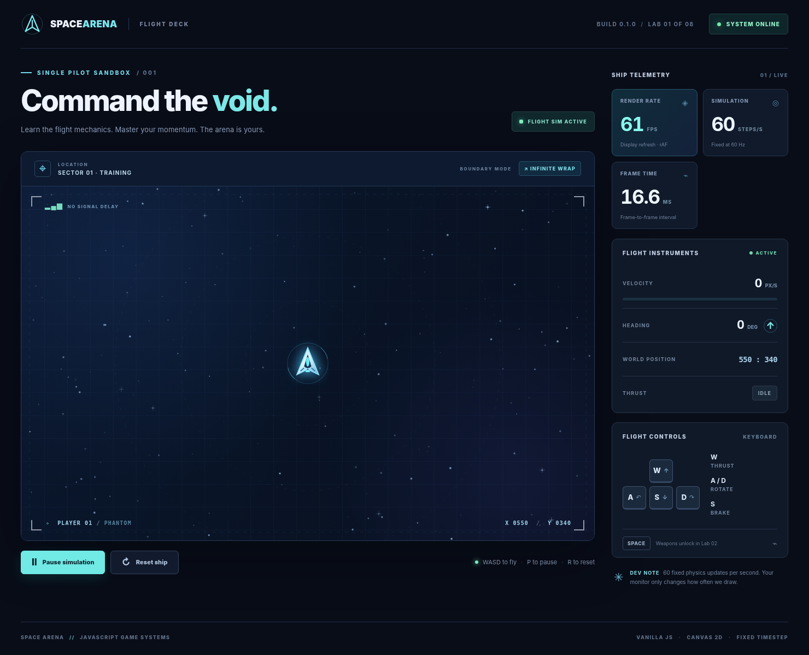

# SPACE ARENA — Lab 01: The Event Loop Is the Game Loop

> A polished, single-player Canvas flight sandbox. The first working milestone of an **eight-lab JavaScript multiplayer game**. Future labs build on this repository; the current tag contains **only Lab 01**, not a finished multiplayer game.



**Course source:** [Lab 01 — The Event Loop Is the Game Loop](https://github.com/rmalkevy/Programming-Practice-Projects/blob/main/courses/javascript/lab-01-event-loop-and-game-loop.md). 

## 1. Run

You need **Node.js 22+** and npm.

```bash
nvm use            # optional, reads .nvmrc (22)
npm install
npm run dev
```

Open the URL Vite displays (normally `http://localhost:5173`).

Quality checks:

```bash
npm run format          # first run: normalize source formatting
npm run lint
npm run format:check
npm test
npm run build
# or all checks together:
npm run check
```

Controls: **W / ↑** accelerate, **A / ←** rotate left, **D / →** rotate right, **S / ↓** brake; **P** pause/resume, **R** reset. On-screen buttons perform the same pause/reset actions. `Space` is intentionally reserved for the Lab 02 weapon system.

## 2. Design and architecture

```text
space-arena/
├── index.html            # semantic UI: Canvas, stats, controls, pause overlay
├── src/
│   ├── main.js           # application wiring, UI state, telemetry, experiment modes
│   ├── loop.js           # createLoop(): fixed accumulator + rAF scheduler
│   ├── input.js          # createInput(): closure over key-state Sets
│   ├── style.css         # responsive visual design
│   ├── sim/
│   │   ├── ship.js       # pure createShip() / integrate()
│   │   └── arena.js      # pure world bounds / wrap-around
│   └── render/
│       ├── canvas.js     # DPR-aware surface and ResizeObserver
│       ├── interpolate.js# shortest-arc angles + wrapped coordinates
│       └── draw.js       # procedural backdrop, custom ship and thruster
├── tests/                # Node built-in tests for deterministic foundation
├── docs/                 # evidence, experiment instructions, reflection answers
├── eslint.config.js
├── .prettierrc.json
├── .nvmrc
└── package.json          # Vite / ESLint / Prettier, ESM
```

**The rendering/DOM code does not leak into `sim/`.** The ship is plain data `{x, y, vx, vy, angle, thrusting}`. `integrate(ship, input, dt)` always returns a *new* state without mutating its arguments, reading real time, accessing DOM, or using random numbers. This separation is intentional: Lab 05 can move it into `shared/` and run equivalent movement on the server.

**Simulation** advances in `1/60`-second steps using an accumulator. **Rendering** happens once on each `requestAnimationFrame` callback, which can be 60, 120, or 144 times per second. The simulation may therefore run 0, 1, or several steps in a draw callback. `alpha = accumulator / fixedDt` blends the previous and current states. For angles, the renderer interpolates the shortest angular arc; for positions, it follows the shortest path across the wrap boundary. Both avoid visual jumps at ±π or map edges.

**Lag safety:** frame delta is clamped to 250 ms; a maximum of 8 physics steps may run on one frame. If the browser stalls longer than the step budget, excess accumulated time is dropped to prevent the spiral of death. This means a prolonged stall cannot be perfectly replayed in real time, but the app remains responsive. `createInput()` captures mutable `Set` variables via a closure and exposes `isDown`, `justPressed`, `snapshot`, `endStep`, `dispose`.

**Graphics:** native Canvas 2D (no game engine). The backing buffer is sized to its measured CSS dimensions multiplied by `devicePixelRatio` (capped at 3). The world uses fixed 1100 × 680 coordinates and scales to the available screen size. ResizeObserver and a window resize event keep it crisp. The backdrop uses a seeded starfield generated once for repeatability; it is purely decorative and does not affect simulation determinism.

## 3. Required experiments: break deliberately, measure, restore

Each experiment is available by adding a query parameter to the Vite URL. The normal URL always uses the correct **fixed-step rAF** implementation:

| Mode | Launch URL | What is deliberately broken |
|---|---|---|
| Baseline | `/?` | Fixed 60 Hz + rAF |
| 1. Block | `/?experiment=block` | Busy-wait 100 ms in every 60th rendered frame |
| 2. Timer | `/?experiment=interval` | `setInterval(tick, 16)` replaces rAF |
| 3. Variable `dt` | `/?experiment=variable` | One simulation call per frame, without accumulator |

To automate the 5-second thrust trajectory test, append `&autothrust=1`, e.g. `/?experiment=variable&autothrust=1`; for the fixed baseline use `/?autothrust=1`. The result is printed to the browser console and appears in a yellow banner. The HUD and a `window.__spaceArenaDebug` **read-only observer** (`getState`, `getStats`, `getMode`) are also available for measurements. The automatic benchmark holds a deterministic thrust input for exactly five **simulation** seconds, starting from the same state each time.

### Measurement environment and methodology

Numbers below are **actual observations in this workspace**, not theoretical or invented outcomes. Because package registry access and browser HTTP navigation were restricted here, a **headless Chromium** harness loaded the same HTML, CSS and JavaScript sources inline (the import/export boundaries were flattened solely for the harness). Code execution was checked for browser errors. The normal player-facing project uses the unchanged ES modules through Vite. Instrument values were sampled roughly every 40 ms during 10-second runs; FPS/steps/s are per-1-second HUD rates. Results vary by machine, browser and system load, so rerun in your own Chrome/DevTools before submission.

| Run (10 s) | Mean FPS | Mean physics steps/s | Mean sampled frame interval | Maximum sampled interval |
|---|---:|---:|---:|---:|
| Correct rAF + fixed `dt` | 59.7 | 59.9 | 16.67 ms | 16.8 ms |
| 1. 100 ms blocking loop | 55.2 | 59.9 | 19.92 ms | 100.1 ms |
| 2. `setInterval(16)` | 62.6 | 60.0 | 15.98 ms | 17.8 ms |

#### Experiment 1 — synchronous freeze

The player sees a small regular stutter: during the 100 ms block the browser cannot run other JS, process most input events or start the next animation-frame callback. The observed mean FPS fell from **59.7 to 55.2**, and a sampled interval reached **100.1 ms**. The simulation caught up using multiple fixed steps, so mean physics rate stayed close to **60 steps/s**. A `while` loop occupies the **call stack** until it completes. Neither `setTimeout`, a resolved Promise nor rAF can interrupt it from the same JavaScript thread. Moving expensive work out of the thread, chunking it into smaller jobs or reducing complexity are meaningful solutions; another callback on that same thread is not.

#### Experiment 2 — timer vs animation frame

The timer delivered **62.6 callbacks/s** in this run, because 16 ms corresponds to a nominal 62.5 Hz, not 60 Hz. Its observed frame-to-frame interval varied roughly between **14.5 and 17.8 ms** in these samples, while rAF was close to display-refresh cadence (**16.5–16.8 ms**). The timer does not align callbacks with the browser's paint schedule. The exact relationship between the timer's callback time and a display refresh may cause uneven visual pacing; browser rules may also throttle timers in background tabs.

**Five-second tab-switch probe:** a second tab was brought to the front in headless Chromium. Over approximately 5 seconds the rAF test produced **24 frame callbacks**, whereas the interval variant produced **317**. However, `document.hidden` stayed `false` in this headless setup. **This does not count as verified real-background-tab behavior**; repeat the 5-second test manually in a regular Chrome window, write down both results and capture a DevTools screenshot. Instructions: [Experiment protocol](docs/experiments.md).

#### Experiment 3 — variable timestep vs fixed timestep

Chrome DevTools Protocol was used to emulate **6× CPU slowdown**. Four runs held identical forward-thrust input for exactly 5 simulation seconds. Output `x=550` throughout, so compare the Y coordinate (the arena wraps vertically):

| Simulation | CPU | Final X | Final Y | Final speed |
|---|---|---:|---:|---:|
| Fixed step | Normal | 550.0000 | **67.8228** | 385 px/s |
| Fixed step | 6× slower | 550.0000 | **67.8228** | 385 px/s |
| Variable step | Normal | 550.0000 | **67.7068** | 385 px/s |
| Variable step | 6× slower | 550.0000 | **64.9210** | 385 px/s |

The fixed step produced the **identical coordinate** under throttling because it integrated an identical sequence of `dt=1/60` updates. The variable-step trajectory differed by about **2.79 world units** between normal and throttled execution: numerical integration of velocity and position depends on the size of each update when `dt` varies. The 6× fixed-step run observed roughly **47 FPS while maintaining 60 physics steps/s**; in the variable run both numbers were roughly **47/s**. This is relevant to Lab 05: replaying different-duration steps on clients and server would produce prediction corrections and visible jitter.

**Important:** This lab does not claim that fixed-step alone makes all engines deterministic across every JavaScript implementation or that all FPS/performance goals are met on every device. It fixes the timestep and removes non-deterministic inputs from our movement rules.

## 4. Verification

The project was checked here with a browser smoke test: 60 FPS / 60 steps/s after startup, forward input changes position and velocity, pause overlay works, no uncaught page errors. All **19 tests** covering physics, wrapping, interpolation, input closure, fixed-step scheduling, and repeatability passed via `node --test`.

**Environment limitation:** `npm install` was attempted but could not connect to `registry.npmjs.org` (`EAI_AGAIN`). Consequently, **Vite production build and ESLint/Prettier checks have not been verified here**. Run `npm run check` on a machine with normal npm access, and commit the generated `package-lock.json` before handing in. Update README once the checks have passed.

## 5. Submission and Git tag

```bash
# When your local tests and experiments are complete:
git add .
git commit -m "Complete Lab 01: fixed-step flight sandbox"
git tag lab-01
# Create a public GitHub repository and add it as origin, then:
git push -u origin main
git push origin lab-01
```

The attached project archive may already contain a **local `lab-01` tag**; check with `git tag -l` to avoid recreating it. Publishing to a public repository must be done from an account you control.

Before final submission, complete the real-background-tab measurements, install dependencies, verify formatting/lint/build locally and push the tag. See [Experiment protocol](docs/experiments.md) and [Reflection notes](docs/reflection.md).

## 6. Roadmap: same game through Lab 08

| Milestone | Feature | Status |
|---|---|---|
| Lab 01 | Ship, fixed-step loop, input, Canvas, performance experiments | **Implemented; external checklist items pending** |
| Lab 02 | Entity/Ship, bullets, asteroids, pickups, homing, collision, score | Planned |
| Lab 03 | Asset loader, audio, lobby, async error handling | Planned |
| Lab 04 | Node HTTP/WebSocket rooms, chat, streamed logs | Planned |
| Lab 05 | Server-authoritative gameplay, prediction, binary protocol | Planned |
| Lab 06 | TypeScript + Zod for client/server/shared | Planned |
| Lab 07 | ≥60 tests, Playwright, CI, profiling and load test | Planned |
| Lab 08 | Docker, metrics, PWA, live HTTPS/WSS deployment | Planned |

This first lab intentionally keeps the ship as a plain object and saves inheritance/`Map`/`Entity` for **Lab 02**, matching the sequence of the course.
