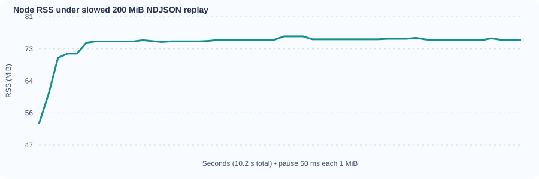

# SPACE ARENA — Lab 04: Node.js · EventEmitter · Streams · WebSocket

> **ЛР №4 у тому самому репозиторії, що й ЛР №1–3.** Клієнтський Canvas, політ, кулі, астероїди, homing, pickup, loading, спрайти й Web Audio залишилися. Додано **Node.js-сервер, живі кімнати, спільний список гравців, WebSocket-чат і потокові NDJSON-реплеї**. Координати/бойову фізику між гравцями **не синхронізуємо**: це предмет ЛР №5.


## 1. Запуск (Mac, Node 22+)

```bash
npm install
npm run dev
```

**Один термінал** запускає Node API/WebSocket на `http://127.0.0.1:3000` і Vite (зазвичай `http://localhost:5173` або наступний вільний порт). Зайди в адресу **Vite**, яку показав термінал, **у двох окремих вкладках/вікнах**. У кожній після Canvas loading обери **одну й ту саму** кімнату, введи **різні імена** та натисни **Join Mission**. Список гравців стане спільним; відправ повідомлення з першого вікна й побачиш його в обох. Можна літати та стріляти локально: **W/A/S/D, Space, Shift+Space, P, R**. Кнопка Lobby надалі від'єднує WebSocket і повертає до списку кімнат.

```bash
npm run format
npm run check      # ESLint + Prettier + клієнтські й серверні тести + Vite build
npm run build      # production client → client/dist
npm start          # Node віддає той самий production client, /api та /ws на :3000
```

> **Не запускайте лише `npm run dev:client`:** Vite спробує проксіювати `/api` й `/ws` до Node. Використовуйте `npm run dev` (обидва процеси). Node сервер — локальна демонстрація, а не публічний хостинг; GitHub зберігає **код**, не запускає його автоматично.

### Структура репозиторію

```text
space-arena/                ← попередній .git, усі теги й історія збережені
├── package.json            ← npm workspaces: client/ + server/
├── package-lock.json       ← генерується npm install, закомітити
├── .env.example            ← змінні оточення
├── client/
│   ├── index.html; src/; public/assets/; tests/
│   ├── vite.config.js       ← dev proxy: /api, /ws → Node
│   └── src/network/connection.js ← reconnect, bounded send queue
├── server/
│   ├── src/index.js         ← HTTP + WS + graceful SIGINT/SIGTERM
│   ├── src/config.js        ← PORT, HOST, LOG_DIR, limits
│   ├── src/http.js          ← built client, API, MIME, traversal guard
│   ├── src/rooms.js         ← EventEmitter rooms + Map
│   ├── src/protocol.js      ← version v0, parsing, validation
│   ├── src/ws.js            ← join timeout, ping/pong, tokens, bufferedAmount
│   ├── src/log/matchlog.js  ← object-mode Transform + pipeline → NDJSON
│   ├── src/log/replay.js    ← async iterator + pipeline → HTTP response
│   ├── scripts/            ← RSS and blocking demos
│   └── test/               ← HTTP, rooms, protocol, WS integration
├── docs/                   ← порівняння, графік RSS, захист і Reflection
└── README.md
```

ESM: усі пакети мають `"type":"module"`, імпорти стандартних модулів записані з префіксом `node:`. У CommonJS натомість `require()`/`module.exports`, синхронне завантаження, змінна `__dirname`. В ESM є статичний `import`/`export`, top-level await і `import.meta.dirname` (для поточного Node); `require()` не є базовим синтаксисом ESM.

## 2. HTTP, кімнати та WebSocket

- `GET /health` → `{ok, uptime, rooms}`; `GET /api/rooms` → `{rooms:[...]}` із **реальною** кількістю приєднаних гравців.
- `POST /api/rooms` → створити кімнату: `curl -X POST http://127.0.0.1:3000/api/rooms -H 'Content-Type: application/json' -d '{"name":"Practice Room"}'`. JSON обмежений 4096 байт; ім'я 2–32 символи, неприпустима форма відкидається. Кількість кімнат і гравців має ліміт.
- `GET /api/replays/:id` → streaming NDJSON (ідентифікатор файлу без шляху; не `readFile`); `GET /` → production `client/dist/index.html` після `npm run build`. MIME, `Content-Length` й відхилення `..`/URL-encoded traversal перевіряються в `server/src/http.js`.
- У Vite `/api` проксіюється на Node HTTP, `/ws` — WebSocket Upgrade. Немає старого статичного `client/public/api/rooms` — цей fixture із ЛР №3 прибрано під час міграції.
- `Room extends EventEmitter`: `join`, `leave`, `chat`, `event`, `empty`; гравці у `Map`. `RoomManager` видаляє **порожню** кімнату, щойно її останній гравець вийшов (початкові кімнати існують, доки їх уперше не використають).
- Протокол **v0**, тільки JSON текст: `{"v":0,"type":"join","room":"orion","name":"Anna"}` → сервер `joined`, `roster`; `{"v":0,"type":"chat","text":"Привіт"}` → трансляція всім у кімнаті; `leave` закриває з'єднання. **Ніяких координат** у мережевих повідомленнях.
- Захист: **join за 5 с**, `maxPayload` 2048 байт (змінна `MAX_MESSAGE_BYTES`), неправильний тип/форма → WebSocket close **1008**, завеликий кадр → **1009**, token bucket 12 msg/s (змінний), ping кожні **15 с**, **два пропущені pong** → terminate; при `bufferedAmount > 64 КіБ` відкидаються некритичні повідомлення або закривається повільний клієнт.
- Браузерний `SocketConnection` ставить `send()` у **обмежену 32 повідомленнями чергу** до встановлення з'єднання, після втрати сокета перепідключається з exponential backoff 0.4–8 с з jitter; після повторного входу `join` повторюється. Імена/чат вставляються як `textContent` (не HTML).

Варіанти налаштування — `.env.example`. Створи `.env`, якщо хочеш змінити `PORT`, `HOST`, `LOG_DIR`, `MAX_ROOMS`, `MAX_PLAYERS`, `RATE_PER_SECOND`, `MAX_MESSAGE_BYTES` або `ENABLE_SLOW_DEMO`. `server/src/config.js` перевіряє числові діапазони; `npm run dev` завантажує `.env` та передає значення **обом** процесам. При `SIGINT`/`SIGTERM`: сервер зупиняє приймання, коректно від'єднує WS-клієнтів, завершує `pipeline` та закриває HTTP із кодом 0 у штатному випадку.

## 3. Потокові match logs і backpressure

Кожна кімната має окремий файл `LOG_DIR/<room>-<timestamp>-<suffix>.ndjson`. `Room.emit('event', {...})` подає об'єкт у `PassThrough({objectMode:true})` → `JsonLinesTransform` → `createWriteStream(file)` через **`stream/promises.pipeline`**. Кожен запис має один JSON-об'єкт на рядок. Коли `write()` дає `false`, вмикається `room.logBackpressured`: нові chat-події тимчасово не записуються до переповненого writer (сервер відповідає клієнту повідомленням «Log stream busy; retry chat»). Подія `drain` знімає блокування.

Файл віддається потоково `pipeline(createReadStream(file), res)`. Ітератор `replayEvents(file)` через `readline.createInterface(...)` парсить рядки окремо — весь файл не опиняється в оперативній пам'яті. Також існує ліміт `bufferedAmount` для WebSocket-клієнтів зі слабким інтернетом.

### RSS-графік: реальний тест 200 МіБ через уповільнений канал



**Методика:** Node 22.16.0, локальний Linux runner. `node server/scripts/rss-benchmark.mjs --mb=200 --pause=50 --out=docs` генерує 200 МіБ синтетичного NDJSON, віддає через **той самий `streamReplay`** і приймає через HTTP-клієнт, який призупиняє читання **на 50 мс після кожного 1 МіБ**. RSS знімається кожні 200 мс. Це **сповільнений локальний HTTP-клієнт**, а не Chrome Network 2G; на Mac/Chrome заміри варто повторити, якщо викладач вимагає саме DevTools throttling.

| Параметр                               |   Фактично виміряно |
| -------------------------------------- | ------------------: |
| Розмір переданого логу                 |          200,00 МіБ |
| Час передачі                           |             10,24 с |
| RSS на старті                          |           52,60 МіБ |
| Максимальний RSS                       |           75,80 МіБ |
| RSS після стартового прогріву (~1.0 с) | приблизно 74–75 МіБ |
| Зразків RSS                            |                  53 |

**Висновок:** початкове зростання RSS ~23 МіБ спричинене прогрівом рантайму, буферами та мережевим стеком; після цього крива майже пласка, хоч передано **200 МіБ**. Це свідчить, що весь лог не накопичувався в пам'яті процесу. Порівняння з `readFile` для 200 МіБ дало б зовсім іншу поведінку. CSV-вибірка: [`docs/rss-lab-04.csv`](docs/rss-lab-04.csv). Дослід відтворюється командою `npm run bench:rss`.

## 4. Event loop (libuv) та навмисна 300 мс зупинка

**Фази Node.js:** `timers` → `pending callbacks` → `poll` (I/O) → `check` (`setImmediate`) → `close callbacks`. `process.nextTick` має власну чергу з вищим пріоритетом, ніж promise microtasks, а обидві виконуються до повернення до відповідних фаз. `setTimeout(0)` проти `setImmediate` з верхнього рівня модуля може мати різний порядок через момент запуску таймерів/poll, а **всередині I/O-callback** `setImmediate` виконується в check після poll. Node виконує JS callbacks на одному event loop thread; I/O може делегуватися ОС/libuv worker pool.

**Демонстрація:** `npm run bench:slow` запускає тестовий HTTP-сервер із дозволеним `/api/slow` (цикл зайнятий 300 мс), паралельно запитує `/health` і показує час відповіді. В нашому запуску: slow **324.9 мс**, health **328.4 мс**: швидкий endpoint теж мусив чекати, хоча не мав важкої роботи. `/api/slow` у звичайному сервері **вимкнено**; щоб ввімкнути, постав `ENABLE_SLOW_DEMO=1` у `.env`. Жоден Promise/HTTP timer не може перервати CPU-bound `while` на цьому самому JS-потоці.

`EventEmitter.emit('error', new Error('boom'))` **без обробника** кидає помилку, що може завершити Node-процес. Мінімальне відтворення:

```bash
node -e "const {EventEmitter}=require('node:events'); new EventEmitter().emit('error',new Error('boom'))"
# Error: boom; process exits non-zero
node -e "const {EventEmitter}=require('node:events'); const e=new EventEmitter(); e.on('error',console.error); e.emit('error',new Error('caught'))"
# prints error; process continues
```

Тому `Room`, `RoomManager`, `http.Server`, `WebSocketServer` і кожен WebSocket мають слухачі `error`; помилки в `pipeline` перехоплюються Promise `.catch`. Необроблене відхилення Promise може завершити сучасний Node-процес залежно від режиму unhandled rejections — `try/catch` або `.catch` є обов'язковими для задач, які можуть завершитися невдало.

**Buffer:** `Buffer.byteLength('привіт', 'utf8') === 12`, тоді як `'привіт'.length === 6`: WebSocket payload cap вимірюється **в байтах UTF-8**, а не кількості JS-символів.

## 5. Що показати за 5 хвилин

1. `npm run dev`, відкрити два вікна Vite. Показати, що `GET /health` і `GET /api/rooms` відповідають.
2. В обох вибрати `Orion Belt`, ввести імена `Anna` та `Bohdan`, натиснути **Join**. Побачити обох у **LIVE ROOM / WS CHAT**.
3. Надіслати `Привіт!` з першого вікна; в другому він з'являється одразу. Показати **політ/постріл**, підкреслити, що між вікнами НЕ транслюються координати.
4. Закрити одне вікно або Lobby → **roster** оновлюється; показати файли NDJSON, `GET /api/replays/:id`, графік RSS.
5. Пояснити `EventEmitter`/`error`, `pipeline`/backpressure й `ping/pong`, відповісти на 2–3 запитання Reflection (див. `docs/reflection-lab-04.md`).

**Контроль:** `npm run check` + ручна перевірка 2 вікон. Попередні експерименти ЛР №1–3 і відповіді залишилися в `docs/`; старий README ЛР №3 збережено як `docs/lab-03-readme.md` під час міграції.

## 6. GitHub / здача

```bash
git status
git add -A
git commit -m "Lab 04: Node HTTP, WebSocket rooms and streaming chat logs"
git tag lab-04
git push origin main
git push origin lab-04
```

**Той самий репозиторій:** https://github.com/top4icsem/space-arena — `lab-01`, `lab-02`, `lab-03`, `lab-04`. Файл `ЯК_ДОДАТИ_ЛР4.md` пояснює розпакування оновлення та міграцію в `client/` + `server/`.

**Основа завдання:** [Lab 04 — Node.js, Streams, WebSocket Server](https://github.com/rmalkevy/Programming-Practice-Projects/blob/main/courses/javascript/lab-04-node-streams-websockets.md) та [Lab 04 Notes](https://github.com/rmalkevy/Programming-Practice-Projects/blob/main/courses/javascript/lab-04-node-streams-websockets.notes.md).
