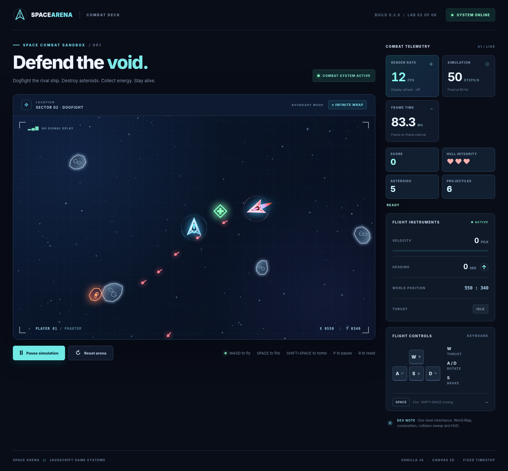

# SPACE ARENA — Lab 02: Objects, Prototypes & `this` (Entity Model)

> **Продовження лабораторної №1 в тому самому Git-репозиторії.** Збережено вихідний Canvas-дизайн, фіксований цикл із кроком `1/60`, фізику польоту, керування, експерименти та тести ЛР №1. Додано бойову арену з класами, сутностями і композицією. **Це все ще локальна однокористувацька гра**, а не готовий мультиплеєр.



## 1. Запуск (Node.js 22+, npm)

```bash
npm install
npm run dev
```

Відкрийте URL, який виведе Vite, зазвичай `http://localhost:5173`. Не запускайте `index.html` просто подвійним кліком: тут використовуються ES-модулі та Vite.

```bash
npm run format
npm run check          # lint + format:check + 36 тестів + production build
```

Тести окремо: `npm test`. Збірка: `npm run build`. Якщо немає Node.js — встановіть [Node.js](https://nodejs.org/) версії 22 або новішої.

### Керування

| Клавіша                 | Дія                          |
| ----------------------- | ---------------------------- |
| `W` / `↑`               | Прискорення вперед           |
| `A` / `←`, `D` / `→`    | Повороти                     |
| `S` / `↓`               | Гальмування                  |
| `Space` (можна тримати) | Звичайні кулі з носа корабля |
| `Shift + Space`         | Самонавідні кулі (фіолетові) |
| `P`                     | Пауза / відновлення          |
| `R`                     | Нова гра / скидання рахунку  |

**Цілі демонстрації:** сірі астероїди — звичайні, помаранчевий астероїд — самонавідний, червоний корабель — суперник, зелений хрест у ромбі — **pickup** (лікує до 3 HP і дає +25 очок). За знищений звичайною/самонавідною кулею астероїд дається +50; за ворожий корабель +200. Після знищення корабля гравець з'являється **через 2 секунди**, з повним здоров'ям. Є частинки вибухів, TTL куль, лічильники HUD і періодичне додавання астероїдів/pickup. Зіткнення працюють також через краї арени (wrap-around).

## 2. Структура проєкту

```text
space-arena/
├── .git/                     # попередня історія і тег lab-01 + локальний lab-02
├── index.html                # той самий інтерфейс + combat HUD
├── src/
│   ├── main.js               # взаємодія з DOM, Canvas і циклом
│   ├── loop.js               # той самий fixed-step requestAnimationFrame з ЛР №1
│   ├── input.js              # керування, Set клавіш
│   ├── style.css
│   ├── sim/
│   │   ├── vector2.js        # immutable Vector2 (pure add/subtract/scale...)
│   │   ├── entity.js         # Entity + private static #id
│   │   ├── ship-class.js     # Ship extends Entity, private #hp, fire()
│   │   ├── world.js          # Map, spawn/despawn/sweep, ofKind(), step()
│   │   ├── behaviors.js      # композиція: ttl, homing, collectible
│   │   ├── factories.js      # створення bullet/asteroid/pickup/particle
│   │   ├── collisions.js     # система колізій коло-коло, O(n²)
│   │   ├── game.js           # правила гри, бали, респаун, ворог, генерація
│   │   ├── ship.js           # фізика integrate() з ЛР №1 — збережена
│   │   └── arena.js          # координати та wrap-around з ЛР №1
│   └── render/
│       ├── draw.js           # кораблі, кулі, астероїди, pickup, частинки
│       ├── interpolate.js   # інтерполяція з ЛР №1
│       └── canvas.js         # DPR із ЛР №1
├── tests/                    # 19 попередніх + 17 нових Node.js тестів
└── docs/
    ├── lab-01-readme.md      # власна доопрацьована версія README з ЛР №1
    ├── reflection-lab-02.md  # відповіді на 3+ питання для захисту
    ├── this-prototype-lab-02.md # приклади 4 правил this і прототипів
    ├── defense-lab-02.md     # сценарій п'ятихвилинного захисту
    ├── experiments.md       # експерименти ЛР №1, не вилучені
    └── reflection.md        # рефлексія ЛР №1, не вилучена
```

## 3. Об'єкти, прототипи та інкапсуляція

**`Vector2`**: кожна дія (`add`, `subtract`, `scale`, `normalized`, `rotated`, `distanceTo`) повертає нове значення, аргументи не змінюються; `Object.freeze(this)` захищає координати вектора. У `Entity` зберігаються `id`, `position: Vector2`, `velocity: Vector2`, `radius`, `kind`, `team`, `alive`, `behaviors`, метод `update(dt, world)`. `Entity.#id` — **приватний статичний лічильник**; ID видається в конструкторі і не повторюється. `Ship extends Entity` — **єдиний рівень наслідування**. Здоров'я `Ship.#hp` заховане від зовнішнього коду, але доступне читання через `get hp()`. Метод `damage()` керовано змінює HP. І ворог, і гравець є екземплярами `Ship` (ніякого `EnemyShip extends Ship`).

### `World`, `Map` і відкладене видалення

`World.entities` — `Map<id, Entity>`: `spawn(entity)` додає, `despawn(entityOrId)` лише ставить `alive = false`, а `sweep()` видаляє після кроку. Всі сутності можна перебирати циклом `for (const e of world)`; `*ofKind(kind)` — **генератор**, повертає тільки живі сутності зазначеного виду. `World.step(dt)` викликає `update()` на знімку живих сутностей, запускає окрему систему колізій та виконує `sweep()`. Завдяки знімку додані під час кроку об'єкти не отримують несподіване друге оновлення.

### `this`: баг, виправлення, альтернативи

У звичайному методі `Ship.fire()` використовуються `this.position`, `this.velocity`, `this.angle`, `this.fireCooldown`. **Помилка:**

```js
const fire = ship.fire;
fire(); // TypeError: втрачений this в ES module / strict mode
window.addEventListener('keydown', ship.fire); // this === window, а не ship
```

**Правильно використано у грі:** `const bullet = game.player.fire({ guided: true });` — метод викликається через екземпляр. Для передавання в listener:

```js
const fireBound = ship.fire.bind(ship); // зв'язаний this
window.addEventListener('keydown', fireBound); // прибрати пізніше: removeEventListener
// Або замикання / стрілка, яка захоплює змінну ship:
const onFire = (event) => {
  if (event.code === 'Space') ship.fire();
};
window.addEventListener('keydown', onFire);
// Або для негайного виклику: ship.fire.call(ship, { guided: false });
//                             ship.fire.apply(ship, [{ guided: true }]);
```

**Чотири правила `this`:** (1) `new Fn()` → новий об'єкт; (2) `fn.call(obj)` / `.apply(obj)` / `.bind(obj)` → явне прив'язування; (3) `obj.fn()` → об'єкт зліва від крапки; (4) звичайний `fn()` → `undefined` у strict mode (або глобальний об'єкт поза ним). Вони перелічені у порядку пріоритету. **Стрілкова функція** не має власного `this` і бере його з лексичного оточення; у `()=>ship.fire()` ми також явно викликаємо метод екземпляра. Покроковий консольний експеримент — [docs/this-prototype-lab-02.md](docs/this-prototype-lab-02.md).

**Прототипний ланцюжок (ОДИН експеримент):**

```js
const ship = new Ship(); // у Node: імпорт із './src/sim/ship-class.js'
Object.getPrototypeOf(ship) === Ship.prototype; // true
Object.getPrototypeOf(Ship.prototype) === Entity.prototype; // true
Object.getPrototypeOf(Entity.prototype) === Object.prototype; // true
```

## 4. Дизайн-запис: чому композиція, а не дерево класів (коротко)

**Як могла б виглядати погана ієрархія:** `Entity → MovingEntity → Enemy → Asteroid → HomingAsteroid`; окремо `Entity → Projectile → HomingBullet` і `Entity → Item → HealingPickup`. Насправді самонаведення потрібне і кулі, і астероїду, хоча це зовсім різні типи. Pickup має бути нерухомим, збиратися при дотику, але не бути «кораблем» або «підкласом ворога». Глибоке дерево дублювало б наведення й породжувало б суперечливі типи.

**Наш вибір:** `Entity`, від нього **тільки** `Ship extends Entity`; для кулі/астероїда/pickup/частинок фабрики створюють звичайні `Entity` з потрібним `kind` і **масивом здібностей** (`behaviors`). `homing({ target, speed, turnRate })` додається до кулі **і** астероїда; `ttl(seconds)` — до кулі та частинок; `collectible(onCollect)` — до pickup. Всі використовують один контракт `behavior.update(entity, dt, world)` і не вимагають нового `extends`. Колізія перевіряє `kind` / здатність collectible; pickup нерухомий (`velocity = (0,0)`) й не є `Ship`. Переваги: повторне використання, просте тестування, незалежні ознаки, можливість комбінувати. Ціна: `kind`/контракти поведінки треба узгоджувати; типи не гарантуються компілятором у чистому JS.

## 5. Колізії, TTL, респаун і HUD

- `circlesOverlap()` у `collisions.js` порівнює квадрати відстаней з урахуванням переходу через край. `resolveCollisions()` — O(n²), достатньо для десятків об'єктів; частинки не перевіряються.
- Bullet має TTL 2,1 с (guided 3,4 с). При зіткненні з астероїдом/чужим кораблем гине куля; у астероїда є `durability`, у корабля `#hp` та невеликий захист після удару.
- `Game` розбирає події з `World.step`: на `destroyed` створює 17 частинок, оновлює `score`, запускає двосекундний респаун гравця; суперник повертається через 4 с. `R` скидає симуляцію.
- HUD показує `score`, HP, кількість куль/астероїдів, таймер респауну, швидкість, курс, координати, FPS і кроки/с. Задній фон та інтерполяція Canvas збережені.
- Збережені режими ЛР №1: `?experiment=block`, `?experiment=interval`, `?experiment=variable`, `?autothrust=1` (останній **вимикає бойову арену** і запускає старий контрольований 5-секундний політ).

## 6. Перевірка і здача

**Перевірено в робочому середовищі:** `node --test tests/*.test.js` — **36/36 passed**, включно з 19 попередніми тестами ЛР №1. `npm install` тут не зміг завершитися через недоступність npm registry; тому результат `npm run lint`, `npm run format:check` і `npm run build` треба перевірити **локально після інсталяції пакетів**. Не видаємо це за пройдену збірку. Команди вище для цього і наведені.

**Увага:** архів містить Git-історію з `lab-01` і підготовлений локальний тег `lab-02` (якщо він створений у цій копії). **Ніякого автоматичного завантаження в GitHub не відбувається:** для здачі треба перевірити remote та виконати push у СВІЙ попередній публічний репозиторій. [Покрокова інструкція](ЯК_ЗДАТИ_ЛР2.md).

```bash
git log --oneline -3
git tag -l             # lab-01 і lab-02
git remote -v          # перевірити підключення до GitHub
npm install
npm run format
npm run check
git add .
git commit -m "Finalize Lab 02 after local verification"  # лише якщо є зміни
# Якщо ви змінили код після створення lab-02, перенесіть тег на новий коміт:
git tag -f lab-02
git push -u origin main
git push origin lab-01
git push origin lab-02        # якщо тег уже був на remote: git push --force origin lab-02
```

**Захист 5 хв:** показати `Ship` → стрільбу → знищення астероїда/ворога → зелений pickup → homing `Shift+Space` → HP/респаун, а потім у коді `Vector2`, `Entity`, `World`, `behaviors.js`, `collisions.js`. [Готовий порядок виступу](docs/defense-lab-02.md); [Reflection](docs/reflection-lab-02.md).

### Спадкоємність з ЛР №1

Перший етап НЕ переписаний з нуля: `src/loop.js`, `src/input.js`, `src/sim/ship.js`, `src/sim/arena.js`, `src/render/canvas.js`, `src/render/interpolate.js` залишені як базові модулі; файл `docs/lab-01-readme.md` зберігає ваш власний оновлений опис першої лабораторної з реальними вимірами на MacBook Air. Тег `lab-01` дає змогу окремо перевірити стан гри до бойової системи.
