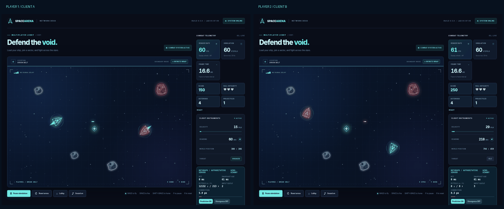

# Space Arena — Lab 05: Server-authoritative realtime networking

> **Course:** Programming Practice. One evolving repository; tags `lab-01` … `lab-05` capture separate milestones. Lab 05 adds live multiplayer combat with server-owned state, shared physics, binary WebSocket packets, prediction, reconciliation and a network HUD. Lab 04 chat, asset loading and streamed match logs are retained.



**GIF provenance:** This is a Chromium **client-rendering smoke preview** made using a deterministic WebSocket test double (two client pages with different player IDs and shared sample snapshots). It demonstrates the appearance of two ships, live netgraph and animation; it **does not prove the actual Node `ws` server was exercised**. For submission evidence, run the real two-tab test below and replace this GIF with a screen capture of your local server session. The Node WebSocket integration test runs under `npm run check` once the `ws` dependency is installed.

## 1. Start the existing repository (Node.js 22.12+)

```bash
npm install
npm run format
npm run check
npm run dev
```

Open the **Vite URL printed by the terminal**, typically `http://localhost:5173/`. In development the Node server listens on `http://127.0.0.1:3000`, while Vite proxies `/api` and `/ws`. If 5173 is occupied, use the next port Vite prints; **do not open only the Node API address for gameplay**. Production: `npm run build && npm start` and visit Node's port.

In two windows: enter `Player1` and `Player2`, choose **the same** Orion/Nebula/Zenith room, click **JOIN MISSION**. Both see **two controllable ships in the same server-simulated world**, plus the existing chat, asteroids, bullets, pickups, lives and score. W/↑ accelerates, A/D turns, S brakes, Space fires, Shift+Space homes; P pauses only local client rendering (the server **does not stop**). R resynchronizes the local visual offset; it cannot teleport an authoritative ship. The reset and pause behaviors differ from earlier single-player tags.

The **three built-in rooms are persistent** (`orion`, `nebula`, `zenith`) and survive all departures. Custom rooms created via POST `/api/rooms` still disappear on empty, honoring Lab 04 cleanup. Check `http://localhost:3000/api/rooms`: it should show **all three** immediately after starting the server and after all clients leave.

## 2. Architecture / trust boundary

```text
repo/
├── client/                 Canvas, lobby, input, Web Audio, netgraph
│   └── src/network/
│       ├── connection.js   WebSocket reconnect, DataView input / snapshots
│       └── netcode.js      local prediction, replay of unacked inputs, interpolation
├── server/
│   └── src/
│       ├── ws.js           join/chat/protocol validation, flow control, heartbeats
│       ├── rooms.js        3 persistent presets + transient user rooms
│       └── network/
│           ├── ticker.js   30 Hz drift-corrected setTimeout scheduler
│           └── realtime.js SharedWorld per room, individual snapshot ACKs
├── shared/
│   ├── flight.js           canonical pure ship physics, fixed STEP=1/30
│   ├── world.js            authoritative ships, bullets, rocks, pickups, scoring
│   ├── prng.js             seeded world random generator
│   └── codec.js            binary input + snapshot encoding (little-endian)
└── docs/                   GIF, defense script, measurements, reflection
```

**Never accept coordinates from clients.** The `join` handshake tells the client its numeric network ID and server-supplied seed. Each subsequent input carries only a monotonic `seq` and a mask of controls (`thrust`, `left`, `right`, `brake`, `fire`, `guided`). The server checks packet shape/length and rate limits; even if a browser edits local `x`, the next authoritative snapshot overwrites it. `SharedWorld` owns ship coordinates, bullet creation, collisions, damage, score and respawn. Both browser and server import **one actual `shared/flight.js`** and use the same `dt = 1/30` with no calls to `Date.now()` or `Math.random()` inside the shared simulation. Random asteroid placement uses a seeded PRNG. Server ownership improves cheating resistance; it does not provide full anti-cheat (aimbots and prohibited input automation are separate problems).

The server scheduler maintains a target due time using `performance.now()` + `setTimeout`, executes bounded catch-up steps (max 3), then schedules to the **next target**, rather than using `setInterval` for physics. World advances 30 ticks/s; every **second** tick is broadcast (15 snapshots/s) to cap bandwidth. Ping/pong and chat from Lab 04 continue separately. One room has one world, not a local `Game` instance per real player.

## 3. Latency, prediction and reconciliation

**Comparison experiment:** `?predict=0&latency=100` disables local prediction. Hold W: the ship updates only when a delayed snapshot arrives, clearly exposing the round trip and snapshot cadence. The right-side button **Server only** / **Prediction ON** toggles prediction at runtime. With prediction on, browser applies its newest input to its own displayed state **immediately** (`advance`), while still sending the same input to the server; the server confirms the last processed `seq` in every snapshot.

On receiving a snapshot, the browser:

1. Finds its ship's **authoritative** position and last acknowledged input sequence.
2. Drops local input entries with `seq ≤ ack`.
3. Replays all **remaining** inputs over the authoritative position using the shared physics, in sequence.
4. Measures the discrepancy and blends the **rendered** correction toward zero using exponential easing with a time constant of about **100 ms**. The authority itself is never slowly blended or compromised.

Other ships and remote bullets/rocks are rendered at `latest server tick − 120 ms`, between bracketing snapshots (shortest wrap-around interpolation). **Why 120 ms?** At 15 snapshots/s, spacing is about 67 ms; 120 ms normally provides two snapshots even under moderate jitter at the cost of 120 ms visual delay. For very large jitter, it briefly clamps instead of inventing future state; a full production client would adapt this buffer dynamically.

Own muzzle flash and a short-lived **ghost bullet** render instantly, then real server bullets arrive; server decides actual hit/damage. With `?latency=100&jitter=25&loss=0.05`, the demo adds **application-layer** delays (100 ms nominal RTT, half each direction), ±25 ms jitter and 5% input/snapshot omission. WebSocket itself remains ordered/reliable; skipped application messages mimic dropped game packets and later inputs must still be independently acknowledged. These values aren't a measurement of actual internet latency.

**Divergence investigation:** click **Divergence OFF** to turn it ON (or use `?diverge=1`). This deliberately inserts random displacement **on the client prediction path** after the shared `integrate` call, not in the server: the netgraph's `CORRECTION` rises, proving why random physics break replay. Click OFF to remove the fault. The canonical `shared/flight.js` remains deterministic; if practicing the textbook experiment, temporarily add `Math.random()` directly inside `integrate`, observe mismatch, **restore it** and rerun tests. The visible toggle safely reproduces that effect without leaving broken shared code in the submitted tag.

### Netgraph fields

| Metric        | Meaning                                                                                                       |
| ------------- | ------------------------------------------------------------------------------------------------------------- |
| RTT           | Application probe/echo round-trip time (real ping, unaffected by the optional snapshot-only mock delay)       |
| Snapshot age  | Milliseconds since last **delivered** authoritative snapshot                                                  |
| ↓ / ↑ bytes/s | Approximate rolling snapshot bytes received / input bytes sent, app payload excluding WS/TCP headers and chat |
| Input queue   | Count of locally predicted inputs **not yet acknowledged** by the server                                      |
| Correction    | Last reconciliation discrepancy in world pixels; smoothed visually over ~100 ms                               |

**Important implementation caveat:** with application-injected delay, packet omission and a backlog of input messages, pending input replay may temporarily diverge from the server; the next valid snapshot repairs it. This is an educational model, not a latency-compensated competitive shooter.

## 4. Binary protocol, `DataView`, byte order and JSON comparison

`?wire=binary` (default) uses a **version-1** binary framing for gameplay, but keeps join, chat, roster and application probes as version-0 JSON (backward compatibility with Lab 04). `?wire=json` replaces only gameplay input and snapshots with JSON for direct comparison. Restart/rejoin with that URL to change formats. The first two bytes distinguish packet version and type, and multibyte fields are explicitly **little-endian**.

**Binary input (7 bytes):** `u8 version=1 | u8 type=1 | u32 seq LE | u8 flags`; bits are thrust=1, left=2, right=4, brake=8, fire=16, guided=32. No x/y/velocity can be sent. Snapshot (type=2) begins `version, type, tick:u32, ack:u32, playerCount:u8, bulletCount:u16, rockCount:u8, pickupCount:u8` (15-byte header), followed by fixed records: player **29**, bullet **25**, rock **12**, pickup **10** bytes. Positions/velocities are `Float32`, player angle is **signed `Int16`** mapping `[-π,π]` to `[-32767,32767]`; senders and receivers use `DataView` with the same endianness. Scores are `Uint16` for this demo (clamped/wrap if beyond its range; production should use `Uint32`). Malformed or stale input is dropped/closed as appropriate; snapshots are validated before reading.

**Measured from the actual JS encoders, 75 two-player snapshots, 5 initial rocks** using `npm run bench:wire` (environment-independent byte counts; not a wall-clock speed test):

| Packet                                | JSON bytes | Binary bytes | Reduction |
| ------------------------------------- | ---------: | -----------: | --------: |
| One input (`seq=123456`, fire+thrust) |         45 |            7 |       84% |
| Average snapshot (75 frames)          |  **1,350** |      **284** |   **79%** |

Numbers depend on how many bullets/rocks/ships exist at each tick. Header and records differ from Lab 04 JSON chat; input requests cannot include client coordinates.

## 5. Verification and two-window demo

```bash
npm run format
npm run check        # eslint + prettier + Node tests + Vite build
npm run bench:wire   # reproducible JSON vs DataView bytes
npm run dev
```

1. Open two separate Chrome tabs, same URL; join Orion as `Player1` / `Player2`.
2. Confirm two real ships are present **in each tab**, not a bot masquerading as Player2. Move W/A/D independently in both; see both changes propagate. Fire at the other ship/rocks; verify health, scoring and respawn.
3. See netgraph RTT, age, input queue, bytes/s and correction; compare Prediction ON vs Server only under `?latency=100`.
4. Open a second test with `?wire=json` and compare traffic; then turn divergence on and back off.
5. Leave both clients and refresh `/api/rooms`: Orion, Nebula and Zenith remain. Rejoin any of them.
6. Record a **real two-window GIF** on your Mac (screen recording → GIF), save it over `docs/two-clients-lab-05.gif` before final defense; commit that update if desired.

**Verification scope:** deterministic/shared/codec tests and an inline Chromium client UI smoke test were executed while preparing this patch. The test GIF above used a fake socket; full `npm run check`, especially real `ws` integration tests, and real two-window Node gameplay must be confirmed **locally after npm install** on your Mac. Do not claim the mock GIF is proof of server gameplay. The preparation environment could not download npm dependencies.

## 6. Reflection / oral defense

See [5-minute defense script](docs/defense-lab-05.md), [Reflection Q&A](docs/reflection-lab-05.md), and [Network design note](docs/network-design-lab-05.md). Answer why coordinates from browser are untrusted; how ack/replay fixes client prediction; why delay foreign objects ~120 ms; why random numbers need a seed; how DataView and Int16 work; why target-time `setTimeout` beats accumulating timer drift. No client input carries world position.

## 7. Submission

Push new commits to **the same public repository**, then create and push the tag `lab-05` (instructions in `ЯК_ДОДАТИ_ЛР5.md`). Existing tags `lab-01` … `lab-04` stay intact, and `docs/lab-04-readme.md` preserves the previous README after the update script.

Course brief: https://github.com/rmalkevy/Programming-Practice-Projects/blob/main/courses/javascript/lab-05-realtime-networking.md
