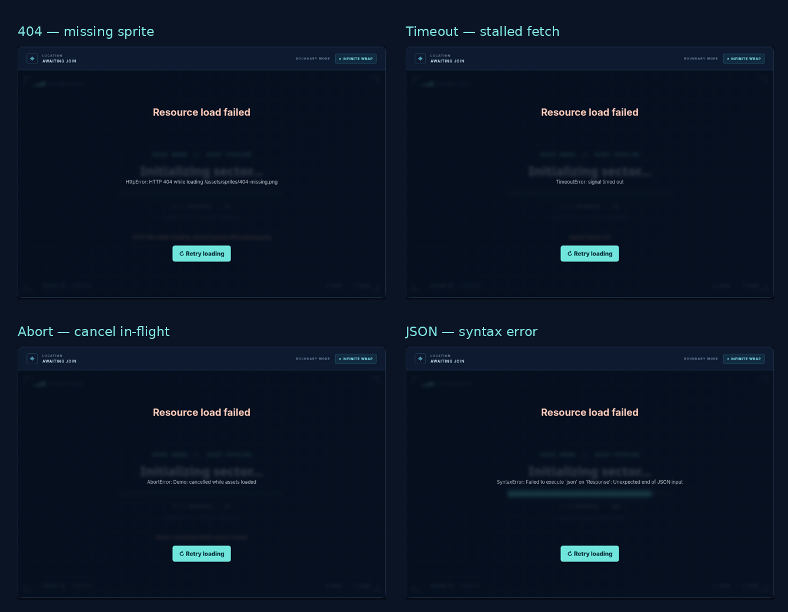

# ЛР №3 — Галерея збоїв: чотири відтворювані сценарії

Використовуйте Vite (`npm run dev`), а не відкритий через `file://` HTML. Ці тести навмисно вмикаються **параметром URL**; самі файли `public/assets/*` не потрібно псувати або видаляти. Кожен тест закінчується відновленням, тому інші студенти можуть повторити його без Git-конфліктів.

1. **404 sprite** — `http://localhost:5173/?failure=404`. `faultManifest()` міняє шлях лише до PNG `ships`. `fetchResponse()` викидає `HttpError(status=404)`; `withRetry()` одразу припиняє спроби, бо 4xx не повторюється. Завантаження зупинено, кнопка **Retry loading** видима.
2. **Timeout** — `http://localhost:5173/?failure=timeout`. Тестовий `fetchImpl` не відповідає на `ships.png`, доки `AbortSignal.timeout(350)` не скасує **кожну** спробу; на timeout можливий exponential backoff. Після вичерпання спроб бачимо `TimeoutError`, а не нескінченний spinner.
3. **Abort during download** — `http://localhost:5173/?failure=abort`. `AbortController.abort()` запускається через 280 мс після початку `loadAll`. Зовнішній сигнал відразу перериває всі файлові запити; `AbortError` показано в інтерфейсі без повторних спроб. Це не те саме, що HTTP timeout.
4. **Broken JSON** — `http://localhost:5173/?failure=json`. Шлях `arena.json` замінюється на доступний, але синтаксично неправильний `broken.json`. HTTP статус 200, однак `response.json()` кидає `SyntaxError`; UI показує помилку, оскільки 200 **не гарантує валідного JSON**.

## Результат реальної браузерної перевірки в цьому середовищі

| Режим   | Побачено                         | Стан після натискання Retry | Неперехоплені browser JS exceptions |
| ------- | -------------------------------- | --------------------------- | ----------------------------------- |
| 404     | `HttpError: HTTP 404...`         | `lobby`, 3 кімнати          | 0                                   |
| timeout | `TimeoutError: signal timed out` | `lobby`, 3 кімнати          | 0                                   |
| abort   | `AbortError: Demo: cancelled...` | `lobby`, 3 кімнати          | 0                                   |
| json    | `SyntaxError: Unexpected end...` | `lobby`, 3 кімнати          | 0                                   |

Тести виконувалися у headless Chromium, де реальні ESM, DOM і ресурси браузер отримував через локальну підміну `fetch`; **сам сервер Vite не перевірено в цьому оточенні**. Висновок: для всіх чотирьох відмов **існує контрольований шлях від помилки до робочої гри** — браузер не падає, користувач натискає Retry, зайшов у лобі, натискає Join.

## Що показати на захисті

Відкрити 404-тест → пояснити, чому не робимо retry на 4xx → натиснути Retry → побачити кімнати → Join. Якщо викладач просить продемонструвати реальний abort, відкрити `?failure=abort` і пояснити різницю між скасуванням **зовнішнім** `AbortController` і `AbortSignal.timeout` на одну спробу. При повторі всіх чотирьох можна використовувати нову вкладку або змінювати query string у адресі.
