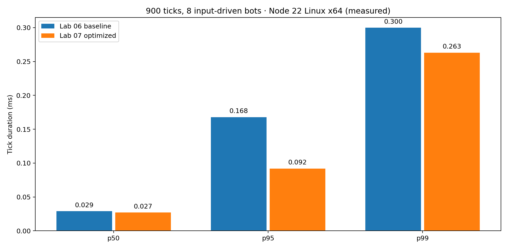

# ЛР №7 — методика вимірювань та чесні обмеження

## Реальний запуск, що вже відбувся

900 кроків (30 **симуляційних** секунд), 8 віртуальних гравців із тими самими `queueInput()` і `seq`, Node.js v22.16.0/Linux x64. Baseline — скопійована реалізація `SharedWorld` з ЛР №6; after — `advanceInto`, compaction in place, `ObjectPool` для куль. Однакові seed, маски input і послідовність кроків. Фінальний snapshot **точно збігся** (див. `docs/lab07-node-world-benchmark.json`).

| Вимір                                               |  До (ЛР6) | Після (ЛР7) |
| --------------------------------------------------- | --------: | ----------: |
| Step p50                                            | 0.0289 мс |   0.0269 мс |
| Step p95                                            | 0.1679 мс |   0.0919 мс |
| Step p99                                            | 0.2999 мс |   0.2630 мс |
| Кількість зареєстрованих GC-подій під час процедури |        35 |          21 |
| Найдовша зареєстрована GC-пауза                     |   0.64 мс |     1.66 мс |

Вимірювання проведено на модельному симуляційному навантаженні в одному процесі. Кількість GC-подій залежить від warmed state, запуску та подій іншого коду; **після оптимізації максимальна зафіксована GC-пауза в цій серії не зменшилася**. Це не доказ, що браузерна гра тримає p99 кадру нижче 16,7 мс.



## Chrome 30 секунд, 8 ботів

Для порівнюваних чистих запусків відкрийте браузер на `/?bots=8` або користуйтеся профайлером:

```bash
npm run dev
# в іншому терміналі
npm run bench:browser -- after
node scripts/render-flame.mjs bench-out/profile-after.cpuprofile
```

Скрипт запише p50/p95/p99 rAF, long tasks, JS heap і реальний Chrome CPU profile до `bench-out/`. Для **before** запустіть той самий профайлер в окремому worktree тегу `lab-06`, з тим самим браузером, розміром вікна, умовами й тривалістю. Відкрийте `bench-out/profile-*.cpuprofile` через Chrome DevTools Performance і збережіть screenshot flame chart у `docs/`. Не малюйте вигаданих результатів до/після.

Пауза GC у Node доступна через `PerformanceObserver({entryTypes:['gc']})`, у браузері для точного розбору слід записати `Performance > Record` / Chrome tracing з категоріями V8 GC. `Performance.getMetrics()` у скрипті показує обсяг JS Heap, але **не** час паузи GC.

## Load 8, 32, 64, 128 клієнтів

Поки працює Node + Vite:

```bash
npm run bench:clients
```

Скрипт дійсно відкриває WebSocket без браузерних вікон, розміщує по 8 гравців у кімнаті та шле бінарні input, зчитує p99 серверного тіку з `/api/perf`. Записує `bench-out/load.json` і `bench-out/load.svg`. У README вставляється графік **після запуску на вашому Mac**. Усе, що показує графік, має бути виміряно; дані з цього середовища не підмінюють реальний 128-клієнтний тест.

## Просторовий хеш

У цій грі 8 ботів і кілька астероїдів. На виміряному ізольованому навантаженні повний серверний тік p99 значно нижче 33,33 мс, тому O(n²) колізія поки не є вузьким місцем — заміна її просторовим хешем без підтвердженого профілю могла би додати ризик і складність. Якщо в тесті на 128 клієнтів p99 перевищує 33 мс, наступний крок — профіль саме `SharedWorld.step` і spatial hash, потім повтор вимірювань.

## Web Worker: проведений експеримент, не увімкнений за замовчуванням

`client/src/perf/starfield.worker.js` рахує 164 координати з тим самим seed без Canvas/DOM, передає `Float32Array` через transfer. Варіант увімкнення: `/?worker=1`. `npm run bench:worker` вимірює startup-worker проти синхронної генерації на основному потоці. Оскільки на 164 зірках запуск Worker може бути дорожчим за саму арифметику, дефолтний шлях лишився синхронним. За результатами на вашому Mac можна переглянути це рішення.
